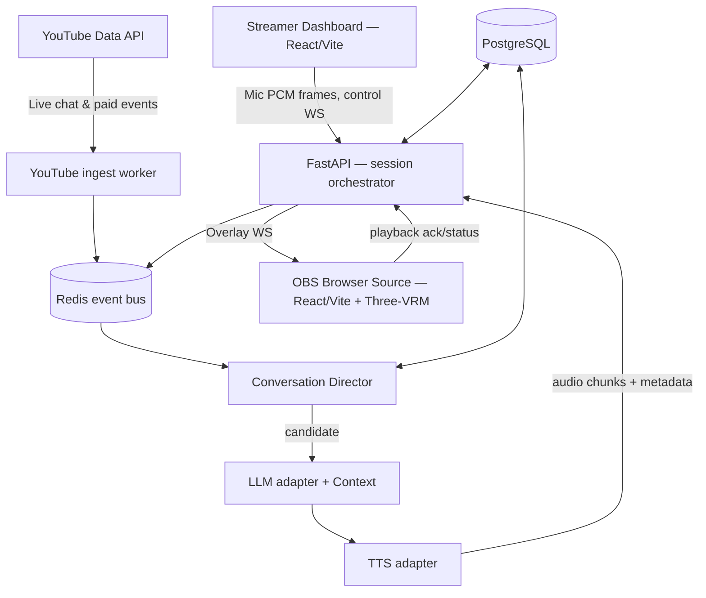

# 02 — System architecture

## High-level



### Trách nhiệm

- **Browser Dashboard:** mic acquisition, VAD/AudioWorklet, quản lý live session, UI chat timeline, event simulator và monitor, không giữ provider API secrets.
- **OBS Overlay:** 3D render, WebAudio playback, animation, connect/reconnect; không đọc mic; không có token OAuth.
- **FastAPI:** Google OAuth, YouTube adapter, STT/LLM/TTS adapters, event normalization, room/session isolation, rate limits, trace, state machine.
- **Redis:** pubsub sự kiện/phòng, TTL, transient session state, short queues và consumer lock (dùng worker đơn trong MVP; chuẩn bị để scale).
- **PostgreSQL:** user, channel connection, character, live session metadata, consent/memory opt-in, aggregates. Không lưu raw audio.

## Repo layout mục tiêu — **giữ template upstream**

```text
.
├── AGENTS.md                   # pack override
├── CODEX_START_HERE.md
├── README.md
├── docs/                       # specs + decisions
├── .agents/skills/             # contextual Codex skills
├── harness/                    # fixtures + validators
├── frontend/                   # UPSTREAM React/Vite/TanStack app + OBS overlay route
├── backend/                    # UPSTREAM FastAPI/SQLModel/Alembic + integrations
├── .github/workflows/          # upstream CI + spec-pack gate
├── [upstream Docker Compose / scripts / .env.example]
└── assets/LICENSE_REGISTER.md  # model/texture/animations provenance (khi có assets)
```

Không tạo thêm `apps/web`/`apps/api` bên cạnh `frontend/`/`backend/` của template; chỉ thay cấu trúc khi có lý do kỹ thuật được ghi ADR.

## Routing local và production

- Dev: `http://localhost:3000` frontend, API có thể chạy `http://localhost:8000` nhưng **web proxy `/api/*` và WS origin kiểm tra rõ ràng**. Nếu proxy WS không ổn, dùng `VITE_WS_URL` dev và whitelist origin đúng domain; không dùng wildcard.
- Production: HTTPS/WSS cùng origin sau reverse proxy: `/api/v1/*` → FastAPI, `/ws/v1/*` → FastAPI, còn lại → Vite-built frontend. OAuth callback URI public cố định; tài khoản app dùng auth upstream, còn consent YouTube là kết nối riêng.
- Dashboard socket authenticated qua **short-lived one-time WS ticket** cấp bằng template user authentication, validate Origin và session ownership; không đưa bearer token dài hạn vào query string hoặc log. Overlay socket authenticated bằng revocable capability token scoped `session_id` (strip query từ logs/referrer), **read-only events + playback ack**, không được gọi control endpoints.

## User session / live session

- Một user có thể sở hữu nhiều nhân vật nhưng MVP chỉ có **một active session per user**; enforce server-side transaction/lock.
- `live_session` có `status = draft|active|paused|stopped|failed`, `mic_state` riêng, `ai_muted` riêng, selected `character_id`, `youtube_chat_id` nếu có.
- Overlay từ OBS không cấp quyền mic/YouTube; chỉ nhận sự kiện khi session active và token hợp lệ.
- Refresh overlay: trạng thái avatar mới nhất và config được gửi, **không phát lại** utterance trước đó.
- Dashboard đóng/mất kết nối: sau grace period cấu hình, chuyển trạng thái degraded hoặc paused, dừng mic ingest/voice-led replies. Chat ingestion có thể vẫn chạy theo lựa chọn cấu hình nhưng AI không tự diễn như streamer vẫn hiện diện.

## Dòng xử lý voice

1. User đồng ý cấp mic cho dashboard; chọn input device.
2. WebAudio + VAD browser xử lý local; AudioWorklet resample frames PCM mono 16kHz, frame ví dụ 20ms (tham số cấu hình). Cần đệm pre-roll khoảng 150–300ms tránh mất âm đầu; **không gửi audio liên tục khi VAD xác định im lặng** nếu provider theo thiết kế cho phép.
3. WS `/ws/v1/dashboard/{session_id}` nhận envelope và frames binary; kiểm tra sequence/frame size; forward STT streaming session.
4. STT trả partial/final và turn-end; Conversation Director quyết định khi nào và liệu có đáp; LLM streaming → TTS streaming.
5. Gửi overlay `speech.start`, audio binary chunks (theo subprotocol định nghĩa), `speech.end`; overlay phát qua **một** AudioContext, gửi `speech.playback.started/completed/cancelled` ack.
6. Streamer nói → phát hiện barge-in → yêu cầu hủy playback hiện hành và abort server-side LLM/TTS. P0 mute phải thắng mọi sự kiện.

## Chat/donate flow

- Google OAuth server-side (scope YouTube read-only) → `liveBroadcasts.list(broadcastStatus=active,broadcastType=all,part=snippet,id,status)` → `snippet.liveChatId`. `mine` and `broadcastStatus` must not be sent together.
- YouTube `liveChatMessages.streamList` push, resume `nextPageToken`, phân loại từ `snippet.type`; fallback `list` theo `pollingIntervalMillis`, tránh vượt quota.
- `provider_message_id` là idempotency key. Khi reconnect có history, **không replay như live**: bootstrap history để context hạn chế (hoặc discard) dựa trên watermark/processed IDs.
- Donate MVP là YouTube Super Chat / Super Sticker; **không tự tạo giao dịch thanh toán**. Giá trị đã được YouTube báo qua API; lưu `amountMicros` và currency chính xác, hiển thị dạng người dùng dễ đọc mà không tự chuyển tỷ giá.

## Quy tắc chịu lỗi

- Every async unit cancellable with `utterance_id` and session generation counter.
- LLM response không hợp thời → cancel trước TTS hoặc `speech.cancel` khi đã phát.
- STT/provider fail → UI warning, local transcript simulator vẫn hoạt động mock; retry exponential backoff có jitter.
- YouTube quota exceeded → disable chat ingestion rõ ràng, không poll liên tục.
- Redis downtime → fail closed cho control/token validation; không chạy detached bot uncontrolled.
- OBS overlay offline → buffer rất ngắn hoặc drop ephemeral speech sau TTL; **không phát bù cả hàng đợi** khi OBS kết nối lại.

## Lựa chọn triển khai

- Ở bản đầu, một FastAPI worker xử lý session loop; không spawn đa worker cho cùng một session nếu chưa có distributed lock.
- Redis Pub/Sub phù hợp event ephemeral, PostgreSQL cho event cần audit như paid acknowledgment; nếu cần delivery guarantees sau beta, cân nhắc Redis Streams.
- Audio streaming có nhiều cách thực hiện (PCM frames qua WebSocket/MediaSource/Web Audio). Ưu tiên **protocol có thể đo được, hỗ trợ hủy ngay**; không phụ thuộc autoplay vô điều kiện trong OBS CEF.
- `three-vrm` render chỉ trên overlay; dashboard preview có thể nhúng cùng component với chế độ âm thanh tắt.
